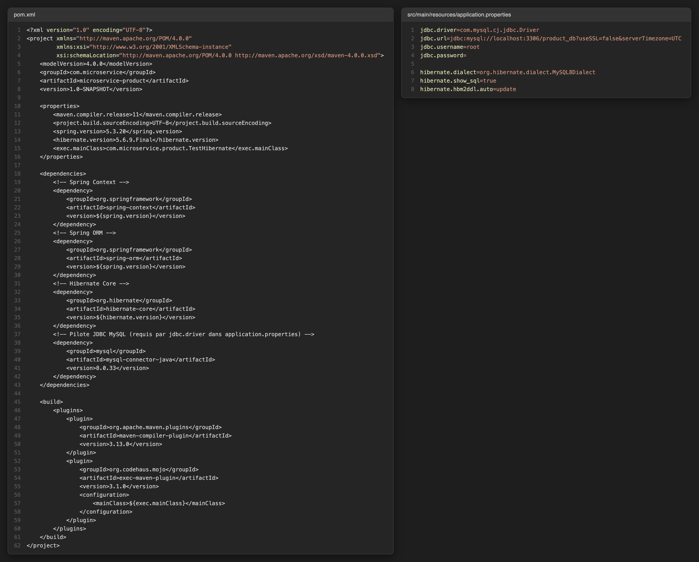
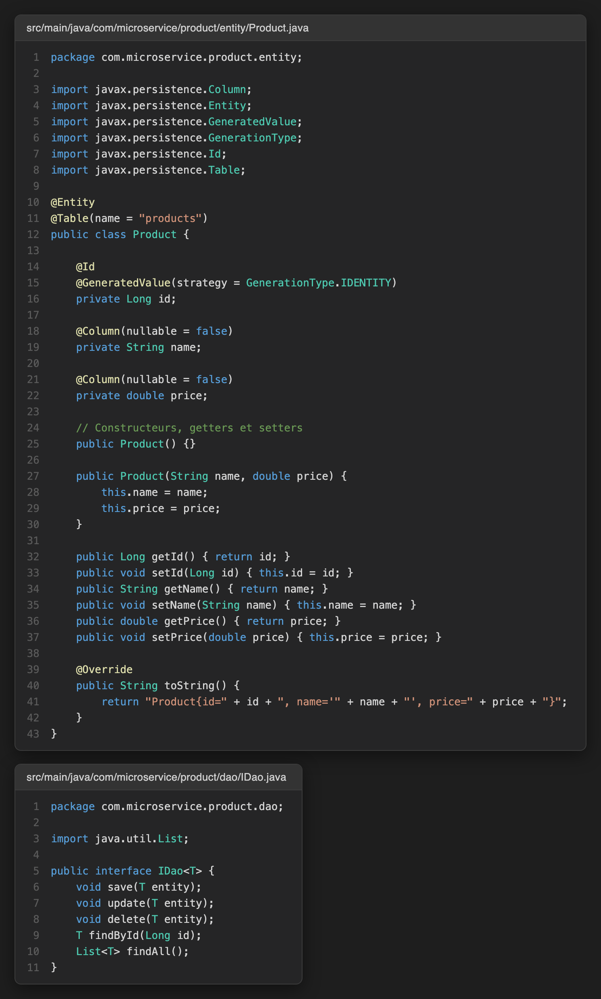
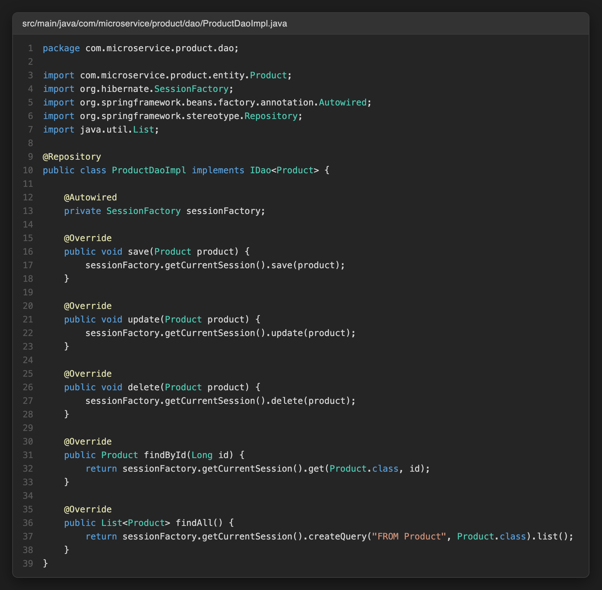
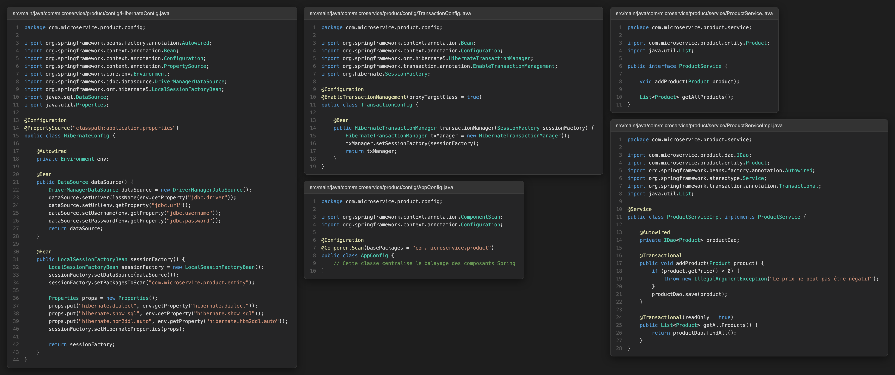
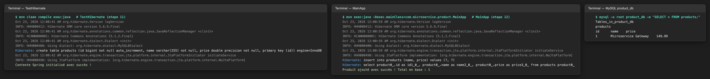

# TP 5 : Intégration de Spring et Hibernate dans une Architecture Microservices

Microservice `microservice-product` : Spring Framework 5.3.20 + Hibernate 5.6.9.Final, pattern DAO générique `IDao<T>`, transactions déclaratives `@Transactional` et persistance MySQL.

## 1. Projet Maven et configuration de la base de données

## 2. Entité Product et interface DAO générique

## 3. Implémentation du DAO Product

## 4. Configuration Spring/Hibernate, transactions et couche service

## 5. Vérification et exécution

